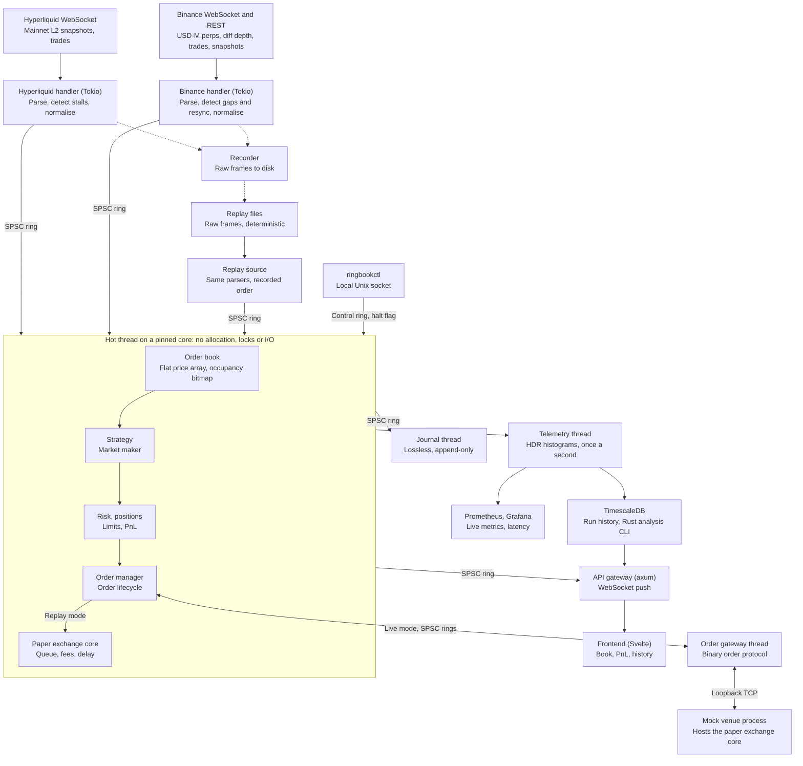

# ringbook: project plan

Last updated: 2026-11-08

## Purpose

An open-source, low-latency crypto trading engine in Rust, built to show a real low-latency trading architecture: exchange connectivity, a lock-free hot path, honest simulation and decoupled telemetry. It trades with simulated (paper) execution against live exchange data; PnL is never the headline. Baseline benchmarks ship with the first release; the full performance study is future work (last section).

## Architecture

Each market data source feeds one pinned hot thread through its own SPSC ring; everything else hangs off the hot thread through lock-free rings, so slow consumers can never add latency to trading.



Acks, rejects and fills flow back through the order manager into risk and positions on the hot thread. Each lower component reads its own SPSC ring and may drop data under load, but never blocks the thread above it. The journal is the exception: it may not lose data, so it halts trading instead (see Journal and recovery).

The hot thread polls its input rings in a fixed order. A live run has one ring per venue, each with a single producer task; a replay run has one ring, because the replay source merges all venues itself (see Event time and measurement). The hot thread also polls the control ring and, in a live run, the execution ring from the order gateway.

## Modular design

ringbook is extended through compile-time plugins: each extension is a crate implementing a small trait, wired into the application binary. Dynamically loaded plugins are deliberately excluded, because Rust has no stable ABI, dynamic calls would prevent inlining on the hot path, and code loaded at runtime could break the hot thread's guarantees.

| Extension point | Trait | First implementations | Dispatch |
| --- | --- | --- | --- |
| Market data venue | `VenueAdapter` | Hyperliquid, Binance | Static; one handler task per venue |
| Trading strategy | `Strategy` | Market maker | Static generic on the engine |
| Execution path | `VenueLink` | In-process paper exchange, order gateway | Static generic on the engine |
| Passive fill estimate | `QueueModel` | Probabilistic queue model | Static generic on the paper exchange |

**Adding a venue**

A `VenueAdapter` supplies the venue's connection details, subscriptions, metadata parsing, frame parser and recovery rules. The generic feed handler and recorder handle everything else, so a new venue means one new crate, one registration line in the application binary and a passing run of the shared adapter conformance suite.

- Venues are selected by name in the config, and an unknown name stops startup.
- `core` has no venue names; each event carries a compact venue ID assigned at startup.
- The hot thread polls a fixed array of input rings, built before pinning and bounded by a compile-time maximum.
- Adapters declare their contract type. The engine supports linear perpetuals, so any other contract type stops startup.

**Dependency rules**

- `core` depends on no other workspace crate.
- Hot-path crates (`core`, `ring`, `book`, `engine`, `paper-exchange`) never depend on Tokio, networking, database or venue crates.
- A venue adapter never depends on another adapter.
- Only the `app` crate knows the concrete implementations and wires them together.

## Languages and tech stack

Rust is roughly 85% of the code; everything else is small and supporting. Five languages are involved, but only Rust carries the engineering story.

| Language | Used for | Key libraries and tools |
| --- | --- | --- |
| Rust | Engine, feed handlers, API gateway, telemetry, run analysis and report charts | tokio, tokio-tungstenite, simd-json or sonic-rs, core_affinity, hdrhistogram, quanta, tracing, metrics and metrics-exporter-prometheus, sqlx, axum, polars and plotters for analysis, criterion for benchmarks, loom, proptest and cargo-fuzz for verification |
| TypeScript | Frontend | Svelte + Vite, a small charting library |
| SQL | TimescaleDB schema and queries | hypertables, continuous aggregates |
| YAML | Local stack, monitoring and CI | docker-compose, Prometheus and Grafana config, GitHub Actions |
| Bash | Host tuning and run scripts | isolcpus, IRQ affinity, CPU governor |

Analysis is Rust too: a small CLI reads TimescaleDB after a run and renders the report charts, so the only non-Rust application code is the thin Svelte frontend.

## Event model

All sources normalise into one fixed-size event, so every book or trade message becomes a sequence of events on the ring.

| Event | Meaning |
| --- | --- |
| BookClear | The levels that follow replace this instrument's book; used for full snapshots |
| BookLevel | Absolute size at a price and side; size zero removes the level |
| Trade | A public trade: price, size and aggressor side |
| VenueStatus | The venue is live, stale or resyncing; the strategy pulls its quotes unless live |

- Every event carries the venue, the instrument, the exchange timestamp if the venue gives one, the event time and a measurement stamp.
- The last event of each exchange message sets an end-of-batch flag. The strategy runs only after a complete batch, so it never sees a half-applied book.
- If a live ring is full, the handler stops publishing, reports the venue as resyncing, and rebuilds the book once the ring has space. A partial batch is never left standing as if it were complete.
- The replay source waits for ring space instead of dropping, so replay stays deterministic.

## Component specs

Every component has one job and one rule it must never break; the hot thread's rule (no allocation, locks or I/O) is the one the whole design protects.

| Component | Job | Must never | Showcases |
| --- | --- | --- | --- |
| Feed handlers | Connect to Hyperliquid (L2 snapshots, trades) and Binance USD-M perpetuals (diff depth, trades), parse, normalise into the event model | Block the hot thread; leave a broken book in place (see Feed integrity) | Tokio, WebSocket, fast JSON parsing, gap and stall detection |
| Recorder | Write instrument metadata, every raw WebSocket frame, every REST response and every connection event to a versioned file, each with its venue, stream and receive timestamp | Slow the feed path or alter a frame | Replays that survive parser changes |
| Replay source | Stream recorded raw frames through the same parsers and normalisers as live, at recorded or max speed | Differ between runs: same file, same output at any speed | Deterministic offline demos and tests |
| SPSC ring buffer | Move events between threads | Lock or allocate; head and tail on separate cache lines | Atomics, memory ordering, a little justified unsafe |
| Order book | Per-venue L2 book; cached best bid/ask, with a bitmap to find the next occupied level when the best empties | Allocate per update | Flat price-indexed array vs sorted array vs BTreeMap, cache behaviour |
| Strategy | Simple market maker: quote each venue independently around that venue's mid, with inventory skew | Do anything clever; it is a load generator, not alpha | Clean decision interface |
| Risk and positions | Pre-trade checks (position, notional, order rate, maximum order size, price collar around mid, self-trade prevention), drawdown limit, positions per venue and instrument, PnL from fills | Let an order through that breaks a limit | Incremental updates, kill switch |
| Order manager | Track each order through pending, acked, partially filled, cancel-pending and terminal states, including cancel/fill races | Lose track of an order or apply a venue message twice | Explicit state machine, fixed-capacity order table |
| Order gateway | Pinned, busy-polling thread that encodes orders into a fixed-layout binary protocol and exchanges them with the mock venue over loopback TCP | Put socket I/O on the hot thread | Order entry path, tick-to-wire measurement |
| Mock venue | Separate process that hosts the paper exchange core, takes its own market data and answers orders like an exchange | Reach a real exchange; no real or testnet orders are ever sent | Process isolation, venue-side behaviour |
| Paper exchange core | Simulated matching against the book and public trades, with pending orders in a fixed-capacity queue; a pure state machine with no I/O | Fill unrealistically (see Simulation assumptions) | Honest modelling |
| Journal | Append-only record of every decision, order transition, fill, control command and halt | Lose a record; it halts trading instead | Audit trail, replay debugging, recovery |
| Operator control | `ringbookctl` commands over a local Unix socket: status, halt, per-symbol halt and resume, strategy parameter changes | Be reachable from the network or the public API | Runtime control without touching the hot path |
| Telemetry thread | Collect HDR histograms and counters from the hot thread; publish once per second to the metrics exporter and the storage writer | Be awaited by the hot thread; drop data rather than block | Decoupled observability |
| Metrics | `tracing` for structured logs in every non-hot component; a Prometheus endpoint for counters, feed health and latency percentiles exported as gauges; Grafana dashboards | Touch the hot thread directly | Standard operational tooling |
| Storage writer | Tokio task that takes telemetry snapshots through a bounded channel and writes them to TimescaleDB, retrying the end-of-run summary | Lose a run's summary | Durable storage |
| API gateway | axum, WebSocket push of book, positions and PnL; read-only endpoints for run history and daily PnL from TimescaleDB and the current rules | Read hot-thread state directly; it gets copies via its own ring | Clean read path |
| Frontend | Live books, positions, daily PnL, run history | Grow beyond one page | Enough UI to demo |
| FIX parser (small extra) | Parse and serialise a subset of FIX 4.4 messages, zero-copy | Pretend to be a full FIX engine | Protocol familiarity |

### Order book layout

- Tick sizes and size precision, including Hyperliquid's `szDecimals`, come from each venue's metadata endpoint at startup. The recorder stores that metadata, and replay reads it from the recording, so replay needs no network access.
- Each instrument has a fixed-point scale and a grid at its finest tick, covering a configurable window around a reference price.
- Hyperliquid perp prices allow up to 5 significant figures and at most `6 - szDecimals` decimals, and integer prices are always valid. The usable tick therefore changes with the price's magnitude, so the grid uses the finest tick reachable within the window.
- When the price nears the window edge, the book recentres in place inside its preallocated storage. Recentres are counted.
- Levels outside the window are ignored and counted, not stored.

### Feed integrity

Each venue adapter's parser is a state machine with raw frames and connection events in and normalised events out, with no I/O of its own. Live handlers wrap it with sockets, and replay feeds it the recorded inputs, including REST snapshots.

Connects, disconnects, stall timeouts, failed REST requests and ring-overflow resyncs are recorded as connection events. Replay takes these from the recording and never recomputes them from timing, so a run's outages replay exactly as captured.

**Binance** uses sequence-based recovery, following the venue's local order book procedure:

1. Open the `<symbol>@depth@100ms` stream on the public WebSocket root and buffer its events.
2. Fetch a REST snapshot from `/fapi/v1/depth` and note its `lastUpdateId`.
3. Drop any event whose `u` is below `lastUpdateId`.
4. The first applied event must satisfy `U <= lastUpdateId <= u`.
5. Each later event's `pu` must equal the previous event's `u`; on a mismatch, report resyncing and restart from step 2.

Quantities are absolute and zero removes a level; removing a level the book doesn't hold is normal and not an error.

**Hyperliquid** has no sequence number on `l2Book`, so there are no gaps to detect. Each message replaces the book (BookClear followed by its levels). The failure to detect is a stall: if no book message arrives within a configurable timeout or the socket drops, the venue is reported stale and the handler reconnects. Trade subscriptions are deduplicated after a reconnect using block time, coin and `tid`.

Trade side needs an empirical check, because Hyperliquid's official docs don't define it: `side` is `B` or `A`, reported by third parties as the taker's side, and Binance's aggregate trades are expected to carry a buyer-is-maker flag. A parser test confirms each against recorded trades, by checking which side of the book each trade printed on.

### Order path

The paper exchange core is one state machine with two hosts, and both reach the order manager through the same interface.

| Mode | Where the core runs | Used for | Determinism |
| --- | --- | --- | --- |
| In-process | Called directly on the hot thread, in event time | Replay | Same file, same output at any speed |
| Mock venue | Separate process reached through the gateway, with its own feed connections or replay source, on wall-clock time | Live runs and tick-to-wire measurement | Not deterministic, because two processes race as they would against a real exchange |

The order protocol carries new order, cancel, ack, reject, fill, cancel-ack and heartbeat messages keyed by client order ID, plus queries for open orders and positions. Client order IDs include a run epoch that increases on every restart, so an ID is never reused. Each venue-to-engine message carries a session sequence number, and acks and fills echo the full order details. Configured latencies dominate the microseconds added by loopback. Tick-to-wire on loopback measures the engine's own send path and says nothing about real exchange connectivity.

The hot thread never blocks on the order path, and order messages are never silently dropped.

| Condition | Response |
| --- | --- |
| Connection lost or heartbeat missed | The engine stops quoting, the venue cancels the session's open orders, and the gateway reconnects. Quoting resumes only after reconciliation succeeds |
| Mock venue process dies | Its session state is gone, so the engine enters a global halt with reason `VenueStateLost` |
| Outbound order ring full | The order manager rejects the order locally and counts it; sustained rejection triggers a global halt |
| Inbound execution ring full | The gateway stops reading from the socket, so TCP applies backpressure and no message is lost |
| Order table full | New orders are rejected locally and counted |
| Control ring full | `ringbookctl` returns an error; the global halt flag is unaffected |

### Journal and recovery

- The hot thread writes fixed-size records to a dedicated ring, and a journal thread appends them to a binary file, writing each batch and calling fsync once a second.
- Each run starts with a header holding the full config, its hash and the binary version.
- Every record carries a length and a checksum. During recovery, an incomplete or corrupt record at the end of the file marks the end of the usable journal. Corruption anywhere else stops recovery and leaves the engine halted.
- Journal writes are asynchronous, so a crash can lose the newest records. Recovery treats retransmitted venue messages as the source of truth for that window.
- The ring is sized so normal order rates can't fill it. If it nears capacity, the engine halts with reason `JournalBackpressure`, using reserved space to record the halt and its cancels.
- A journal plus its market data recording reproduces a replay run, including any control commands, which are applied at the batch where they were first applied.

Recovery after a live engine crash runs in this order:

1. When the connection drops, the mock venue cancels the session's open orders, so no further fills can occur.
2. On restart, the engine rebuilds orders, positions and PnL from the journal and starts halted.
3. The gateway reconnects and sends the last applied sequence number. The venue retransmits every later message from a bounded log.
4. Retransmitted messages pass through the order manager. Sequence numbers suppress duplicates, and echoed order details restore anything the journal lost.
5. The engine queries the venue for open orders and positions, and resumes quoting only if they match.

If the state doesn't match, or the venue no longer retains a required message, the engine stays halted and reports the reason through `ringbookctl status`.

### Drawdown limit

Drawdown is the fall in a run's equity from its high-water mark, where equity is realised plus unrealised PnL, net of fees, with open positions marked to each venue's mid. It is updated incrementally from event data, so it remains deterministic in replay. Breaching the configured limit triggers a global halt with reason `Drawdown`.

### Operator control

- A control thread receives `ringbookctl` commands on a local Unix socket, validates them with the same rules as the config file, and passes them to the hot thread through a control ring.
- The hot thread applies commands at batch boundaries and journals each one with its batch sequence number.
- Live parameter changes are limited to strategy parameters. Risk limits, fees, latencies and instruments change only on restart.
- Global halt bypasses the ring: it sets an atomic flag on its own cache line, which the hot thread checks on every loop. New quotes stop on the next loop, and resting orders are cancelled subject to simulated cancel latency, so a fill can still arrive in that window. Open positions stay open.
- A global halt, whether from an operator or the drawdown limit, lasts until restart. Per-symbol halts can be resumed.

### Configuration

- One strategy is compiled in behind a static generic interface.
- Its parameters, risk limits, simulation settings and instruments come from one TOML file passed at startup.
- Unknown fields and invalid values stop startup with a clear error, and risk limits have no defaults.
- Configured instruments are checked against venue metadata, and an instrument the venue doesn't list stops startup.
- The file is compiled into a fixed-size struct of fixed-point values before the hot thread is pinned.
- The public API exposes a read-only copy of the rules and has no routes that change them.

## Build vs. use

Anything on the hot path or central to the engineering story is written from scratch; plumbing uses mature general-purpose crates. No HFT framework is used as a foundation, because then the interesting work would be someone else's.

| Area | Decision | Crates or references |
| --- | --- | --- |
| SPSC ring, order book, strategy, risk, positions, order manager, order protocol and gateway, paper exchange, mock venue, journal, control path, event types, fixed-point prices, FIX parser, telemetry aggregation | Build | None |
| Async I/O and WebSockets | Use | tokio, tokio-tungstenite |
| JSON parsing | Use | simd-json or sonic-rs |
| Latency recording and timestamps | Use | hdrhistogram, quanta |
| Thread pinning | Use | core_affinity |
| Logs and metrics | Use | tracing, metrics, metrics-exporter-prometheus, Prometheus, Grafana |
| Database, API | Use | sqlx, axum |
| Analysis and charts | Use | polars, plotters |
| Benchmarks | Use | criterion |
| Verification | Use | loom, Miri, proptest, cargo-fuzz |
| Existing HFT frameworks | Reference only | barter-rs, hftbacktest (read its queue-position models before writing the paper exchange), NautilusTrader |

## Simulation assumptions

Trades are simulated, and that is fine; what must hold up is the realism of the simulation. A naive simulator (instant fills at mid, no fees, no latency) would produce results with no bearing on real trading.

| Aspect | Naive version (avoid) | This project |
| --- | --- | --- |
| Fill price | Mid price | Bid/ask; aggressive orders walk the visible book level by level, and any remainder beyond visible depth is cancelled and counted |
| Fees | None | Configurable maker/taker fees per venue |
| Latency | Instant | Configurable decision-to-exchange and exchange-to-ack delays, applied in event time |
| Passive fills | Filled when price touches | Estimated queue position: public trades at our level reduce the volume ahead of us, and we fill only after it is gone |
| Size decreases | Treated as trades | A decrease with no matching public trade is a cancel; a configurable probabilistic model decides how much of it was ahead of us |
| Market impact | None | Out of scope; stated as a limitation |
| Funding, margin and liquidation | Ignored silently | Not modelled; stated as a limitation, and reported PnL is labelled as excluding funding |
| Rejects | Never | Simulated rejects for limit breaches and post-only crosses |

Book data is batched rather than per-order, and Hyperliquid's `l2Book` carries 20 levels per side and is pushed at most about every 0.5 seconds. Queue position is therefore an estimate, and a coarser one on Hyperliquid. Large aggressive orders also see only the visible levels. Binance's diff stream excludes Retail Price Improvement orders, so those are not modelled.

The README carries a short "Simulation assumptions" section listing what is modelled and what is not. PnL is reported, but never as the headline.

## Event time and measurement

Trading logic and latency measurement use separate clocks, so a run's decisions never depend on how fast the machine is.

**Event time**

- The feed handler stamps each frame on receipt with a monotonic nanosecond timestamp, and the recorder stores it. That stamp is the event time.
- Strategy, risk and the in-process paper exchange read only event time, including for simulated delays. Time advances only when events arrive. The mock venue is the exception, because it runs on wall-clock time.
- Replay merges venues by receive timestamp, then venue, then per-stream sequence, which gives one total order. Recorded-speed and max-speed replays of a file produce identical fills.
- A replay is deterministic against itself. It does not promise to match the interleaving of the original live run.

**Measurement**

- Only the measurement stamp comes from quanta, and it never influences a decision.
- Tick-to-decision starts when the frame reaches the parser and ends when risk has accepted or rejected the order decision. It includes parsing, normalisation, ring transit, book update, strategy and risk.
- Tick-to-wire has the same start and ends when the gateway hands the order's bytes to the loopback socket. It exists only in mock venue mode. Execution is simulated, so the project does not use the term tick-to-trade.
- Latency is measured on paced replay. Max-speed replay measures throughput only, because its numbers include ring queueing.
- Internal latency says nothing about reaction speed on live data, which is bounded by each venue's update cadence and the network. Performance claims are made from replay only.

**Baseline benchmarks**

- Counting global allocator in tests, proving zero hot-path allocations after warm-up
- criterion benchmarks for the ring and book
- Tick-to-decision histogram from a paced replay: p50, p99, p99.9 and max
- A bench smoke test in CI
- One command reproduces the numbers from a local recording

The repository ships no market data, so unit tests and CI use small frames generated in test code. Published results name the recording's length, date and hash; others can rerun the method on their own recording, but won't get identical numbers.

The allocator test and criterion comparisons run on any development machine. Published latency numbers come from the Linux VPS, and macOS results are never published because it does not honour thread pinning.

## Verification

Each component is tested with the technique best able to falsify its central guarantee.

| Area | Technique | Property verified |
| --- | --- | --- |
| SPSC ring | loom for thread interleavings, Miri for undefined behaviour | No lost, duplicated or torn events under any permitted ordering |
| Order book | Model-based property tests against a simple reference book | Identical state after any update sequence, including recentres |
| Venue parsers | cargo-fuzz, plus scripted gap, stall and resync scenarios | Arbitrary input never panics; every gap leads to a resync |
| FIX parser and order protocol | cargo-fuzz and round-trip property tests | Arbitrary input never panics; encoding and decoding are inverses |
| Order manager | Model-based tests over generated message orderings | Every cancel/fill race and duplicate ends in the correct state |
| Paper exchange | Property tests on generated markets and orders | Queue ahead is never negative, fills never exceed order size, and positions equal the sum of fills |
| Risk | Property tests on generated orders | No order that breaks a limit is ever accepted |
| Determinism | Replay a file twice and at different speeds, then compare journals byte for byte; measurement stamps are excluded from the journal | Identical output in every run |
| Crash recovery | Kill the engine at random points; run recovery on truncated and corrupted journals | State reconciles with the venue, or the engine stays halted |
| Failure handling | Fault injection in the mock venue: dropped connections, missed heartbeats, process death, full rings | Each condition produces its specified response |
| Hot path | Counting global allocator | Zero allocations after warm-up |
| Venue adapters | Shared conformance suite and a fuzz target per adapter | Every adapter meets the same normalisation, batching and recovery contract |
| Crate boundaries | CI check on the workspace dependency graph | The dependency rules in Modular design hold |

CI runs all of these except long fuzzing, which it limits to a short smoke run.

## Repository layout

One public GitHub repository, a Cargo workspace with one crate per component so each can be tested and reviewed on its own.

```
ringbook/
  Cargo.toml              workspace
  crates/
    core/                 event types, prices as fixed-point integers
    clock/                event-time and measurement clocks
    testkit/              allocation-counting test support
    ring/                 SPSC ring buffer
    feeds/                VenueAdapter trait, generic feed handler, recorder
    venues/hyperliquid/   Hyperliquid adapter
    venues/binance/       Binance adapter
    replay/               replay source
    book/                 order book
    engine/               hot thread: strategy, risk, positions, order manager; config
    paper-exchange/       simulated matching core
    gateway/              binary order protocol, gateway thread
    mock-venue/           process hosting the paper exchange core
    journal/              append-only journal, recovery
    ctl/                  ringbookctl and control thread
    fix/                  FIX 4.4 subset parser
    telemetry/            histograms, Prometheus exporter, TimescaleDB writer
    api/                  axum WebSocket server
    app/                  ringbook binary: selects and wires the implementations
  frontend/               Svelte single page
  analysis/               Rust CLI: reads TimescaleDB, renders report charts
  fuzz/                   cargo-fuzz targets
  scripts/                baseline benchmarks, crate boundary check
  configs/                committed trading rules
  infra/
    docker-compose.yml    TimescaleDB, Prometheus, Grafana, app, mock venue, reverse proxy
    grafana/              dashboards
    tuning/               host tuning scripts
  docs/                   ARCHITECTURE.md, SIMULATION.md
  .github/workflows/      build, test, clippy, fmt, loom, Miri, fuzz and bench smoke tests
  LICENSE-MIT, LICENSE-APACHE, README.md
```

## Deployment

The public demo runs on the OVH VPS under docker-compose, with CPU sets assigning each service to its vCPUs.

**Thread placement** (four vCPUs)

| vCPU | Workload |
| --- | --- |
| 0 | Operating system, interrupts, reverse proxy, TimescaleDB, Prometheus, Grafana |
| 1 | Feed handlers, recorder, mock venue, API gateway, journal, telemetry, control thread and storage writer |
| 2 | Hot thread, isolated from the scheduler |
| 3 | Order gateway, busy-polling |

Two vCPUs run at full utilisation by design, so confirm this is acceptable under the provider's terms for shared vCores. Published latency runs stop the database and monitoring stack first.

**Network exposure**

- A firewall denies all inbound traffic except SSH with key-only login and HTTPS.
- A reverse proxy terminates TLS and exposes only the frontend and the read-only API.
- TimescaleDB, Prometheus, Grafana and the metrics endpoint are reachable only on private interfaces; Grafana is accessed through an SSH tunnel.
- The `ringbookctl` socket is accessible only to its owner.
- The API caps WebSocket connections overall and per IP, rate-limits requests and disconnects slow clients once their bounded send buffer fills.

**Storage and retention**

- The engine's journal rotates on a clean restart, which archives it. Archived journals and recordings carry a total disk quota (`infra/tuning/retention.sh`); the oldest closed files are removed first, and active files never are.
- TimescaleDB uses a retention policy, and container logs rotate.
- If the recorder can't write, recording stops and an alert fires while trading continues.
- If the journal can't write, the engine enters a global halt with reason `JournalWriteFailed`.

## Done when

The first release is finished when all of these hold.

- [ ] A replay run trades end to end, and recorded-speed and max-speed replays give identical fills
- [ ] The journal reproduces a replay run
- [ ] The allocator test proves zero hot-path allocations, and baseline benchmark numbers come from one command
- [ ] All tests pass, including every check in the Verification section
- [ ] The engine runs live against the mock venue for an hour, with every Binance gap resynced and every Hyperliquid stall detected
- [ ] A killed engine restarts and reconciles with the mock venue, including messages it missed while down
- [ ] The public deployment exposes only HTTPS and SSH, and enforces its storage quotas
- [ ] `ringbookctl` halts and retunes a running engine
- [ ] `docker compose up` shows live metrics in Grafana and stores a run's stats, and the analysis CLI charts them
- [ ] The live demo works from a fresh clone in under five minutes, given network access to both venues
- [ ] The FIX parser is in place, the public demo runs on the VPS, and v0.1.0 is tagged
- [ ] The README includes the AI-workflow write-up, and a stranger can understand the project from it alone

## Open-source release

Release under a dual MIT / Apache-2.0 licence, the Rust ecosystem's standard, and keep the repository public from the first commit, so its full development history is open.

- [ ] Dual licence files and a licence line in every Cargo.toml
- [ ] No secrets in the repo: any keys or credentials only via environment variables; .env in .gitignore; a secret scanner (e.g. gitleaks) in CI
- [ ] Commit no recorded market data, because exchange terms may restrict redistribution. Ship the recorder only; recordings stay local and are listed in .gitignore
- [ ] README disclaimer: educational project, simulated trading only, not financial advice, no warranty
- [ ] Use the names Hyperliquid and Binance only to describe connectivity; no logos or branding
- [ ] CONTRIBUTING.md and issue templates are optional; a clean README, CI badge and tagged release matter more
- [ ] Write the AI-assisted workflow up honestly in the README (what the tools did, what you designed and verified)

## Risks and decisions

The biggest risk is scope: the first release builds every component together, so integration problems can stay hidden until late.

| Risk | Mitigation |
| --- | --- |
| Size of the first release | Build in dependency order, and get a replay run working end to end before adding the live order path, telemetry or frontend |
| Scope creep in the frontend | Frontend capped at one page |
| Exchange API changes or rate limits | Local recordings keep everything runnable offline and can be reparsed after a format change |
| VPS jitter in published numbers | Every result states its environment; latency is left off the public demo and stays in Grafana |
| Venue access from the VPS region | Check that Binance's API is reachable from the chosen region before committing to a host |

**Decisions**

- Timeline: no deadline
- Frontend: Svelte with Vite
- Symbols: a configurable list, defaulting to BTC and ETH perpetuals
- Name: ringbook
- Market data in the repository: none; a fresh clone runs live, and replay needs a local recording
- Binance feed: USD-M perpetuals, so both venues trade the same instruments
- Real order entry: none; orders reach only the paper exchange core, in-process or in the local mock venue, and no real or testnet orders are sent
- Strategy: one, compiled in; visitors cannot change rules or start runs
- Extensions: compile-time plugins only; no dynamically loaded code
- FIX parser: kept as a small standalone crate
- Message broker: none; one snapshot a second doesn't justify one
- Hosting: the live demo runs and is benchmarked on an OVH VPS-2 running Linux (4 shared vCores) with a public URL

## Design boundaries

ringbook is a low-latency trading architecture built on commodity infrastructure and public market data. It is not presented as a competitive high-frequency system, and its internal latencies are not comparable with production colocated systems. Each boundary below follows from that setting and has a clear way forward. The README states them up front.

| Area | Choice in this release | Way forward |
| --- | --- | --- |
| Performance evidence | Baseline benchmarks prove the core guarantees: zero hot-path allocations, plus ring, book and tick-to-decision numbers | The full performance study adds layout comparisons, profiling and assembly analysis (next section) |
| Hardware | An affordable shared-vCore VPS that anyone can rent; results are labelled as VM measurements | Bare metal would tighten tail latency and expose CPU performance counters; the benchmark method carries over unchanged |
| Network and market data | Standard kernel sockets, with the JSON WebSocket feeds and batched L2 data that public crypto venues offer | Kernel bypass, FPGAs, hardware timestamps, colocation and binary per-order feeds are out of scope; parsers take raw frames and do no I/O, so a faster transport or format can replace them without touching the engine |
| Language | Rust, for memory safety with the same control over layout and allocation as C++, the field's traditional language | The design is language-independent: fixed-size events, lock-free rings and a pinned, allocation-free hot thread |

## Future implementation: full performance study

Out of scope for the first release; picked up after it ships and built on the baseline benchmarks. When it lands, every performance claim is measured on replay data, reported as percentiles and reproducible with one command from a local recording, and PERFORMANCE.md becomes the project's main performance document.

**Metrics**

- Tick-to-decision latency, as defined in Event time and measurement: p50 / p99 / p99.9 / max
- Tick-to-wire latency on loopback, in mock venue mode
- Order book update latency per venue
- Throughput: events per second through the hot thread
- Ring buffer depth and drops
- Allocations on the hot path: must be zero, proven by the counting global allocator

**Method**

- Timestamps with quanta (TSC-based); latencies recorded into HDR histograms, never logged per event
- Microbenchmarks with criterion for the book, ring and parser
- perf stat for cache misses and branch misses; flamegraphs for hot spots
- cargo-show-asm for the generated assembly of one or two hot functions
- Every result states the machine, kernel, CPU pinning and replay file used

**Planned optimisation rounds for PERFORMANCE.md** (each with before and after numbers)

1. Order book: BTreeMap vs sorted array vs flat price-indexed array with bitmap, with cache-miss counts if the VPS exposes them
2. Data layout: array-of-structs vs struct-of-arrays for levels and positions
3. Threading: unpinned vs pinned vs isolcpus, effect on p99.9
4. Parsing: serde_json vs simd-json or a hand-rolled parser for the hot message types
5. Assembly: annotate the generated code for the book update
6. Feed threads: Tokio handlers vs a pinned, busy-polling non-async thread, effect on p99 and p99.9

**Environment and baselines**

- Run benchmarks on the OVH VPS. Shared vCores add jitter, and pinning binds to a vCPU rather than a physical core, so every result says it came from a VM
- If the VPS hides CPU performance counters, the affected rounds report timings only and say so
- Benchmark the hand-rolled SPSC ring against rtrb and crossbeam queues
