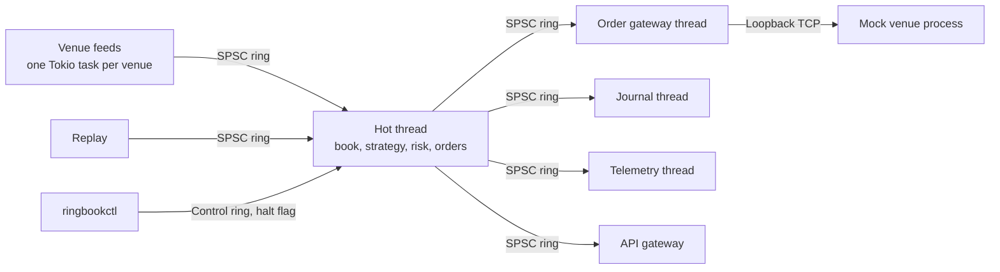

# Architecture

ringbook has one rule that the rest of the design protects: the hot thread never allocates, locks or performs I/O once it is running. Everything else exists to keep that true while still connecting to exchanges, recording data, serving a website and surviving crashes.

## Data flow



Every arrow out of the hot thread is a bounded single-producer, single-consumer ring. Telemetry and API rings drop data when full. The journal ring can't, so the engine halts instead of losing a record.

## Two clocks

Trading logic reads only **event time**, the timestamp stamped when a frame was received. The recorder stores it, so a replay sees the same times as the original run.

Latency is measured with a separate counter, and its stamps never reach trading logic. `MeasureStamp` deliberately has no ordering, so comparing against it doesn't compile.

## Why replay is deterministic

- Parsers are state machines with no I/O, driven by recorded inputs that include REST responses and connection events.
- Venues merge in one total order: receive timestamp, then venue, then per-venue sequence.
- The in-process paper exchange only advances at batch boundaries, so reports can't depend on thread timing.
- Operator commands apply at batch boundaries and are journaled with their batch number.

Two replays of a recording produce byte-identical journals at any speed. The tests in `crates/app/tests/e2e.rs` check this.

## Extension points

Each extension is a crate implementing a small trait, wired up in `crates/app`. All are statically dispatched.

| Extension point | Trait | Crate |
| --- | --- | --- |
| Market data venue | `VenueAdapter` | `crates/feeds` |
| Trading strategy | `Strategy` | `crates/engine` |
| Execution path | `VenueLink` | `crates/engine` |
| Queue position model | `QueueModel` | `crates/paper-exchange` |

To add a venue, create a crate under `crates/venues/`, implement `VenueAdapter`, add it to `crates/app/src/registry.rs`, and run the checks in `ringbook_feeds::conformance` from its tests.

`scripts/check-deps.sh` enforces the crate boundaries in CI: hot-path crates can't depend on networking, databases or specific venues.

## Failure handling

| Condition | Response |
| --- | --- |
| Binance sequence gap | Report resyncing, rebuild from a REST snapshot |
| Hyperliquid stall or disconnect | Report stale, reconnect; the next snapshot heals the book |
| A venue isn't live | Pull that venue's quotes |
| Connection to the mock venue lost | Stop quoting; the venue cancels open orders; reconcile on reconnect |
| Mock venue restarted | Global halt, `VenueStateLost` |
| Engine killed | Rebuild from the journal, fetch missed reports, reconcile, then resume |
| Journal can't keep up or be written | Global halt |
| Drawdown limit breached | Global halt |

## Recovery after a crash

1. When the connection drops, the mock venue cancels the session's open orders, so no further fills can occur.
2. The engine rebuilds orders, positions and PnL from the journal and starts halted.
3. The gateway reconnects with the last applied sequence number, and the venue retransmits everything later.
4. Sequence numbers suppress duplicates, and details echoed in each report restore anything the journal lost.
5. The engine queries open orders and positions, and resumes quoting only if they match.

A run that starts without a journal opens a new venue session, so it starts flat. If the venue restarts while a journal still refers to its old session, the engine halts with `VenueStateLost`: that run's state can't be reconciled, so archive the journal to begin a new run.

A recovered run keeps its run ID, because the ID is stored in the journal header. It stays one run in storage, and its PnL carries on. A run is meant to last across days: `/api/daily` reports each UTC day's PnL as the change from the previous day's last equity sample, and open positions carry over at their current value.

## Operating a run

```sh
ringbook validate configs/demo.toml
ringbook record --config configs/demo.toml --out recordings/today --seconds 3600
ringbook verify-recording --config configs/demo.toml --recording recordings/today
ringbook replay --config configs/demo.toml --recording recordings/today --journal journals/a.rbj

ringbook mock-venue --config configs/demo.toml &
ringbook live --config configs/demo.toml --journal journals/live.rbj

ringbookctl status
ringbookctl set spread_bps 6
ringbookctl halt-symbol BTC-PERP
ringbookctl resume-symbol BTC-PERP
ringbookctl halt
```
